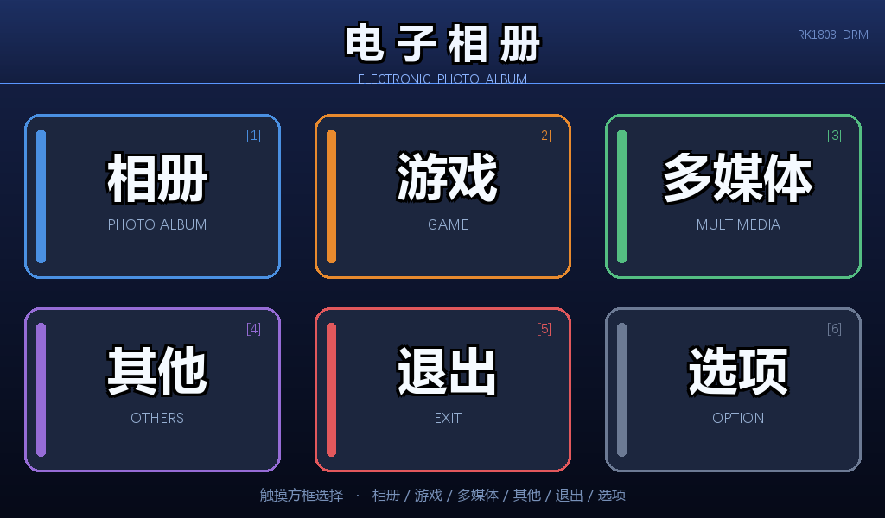
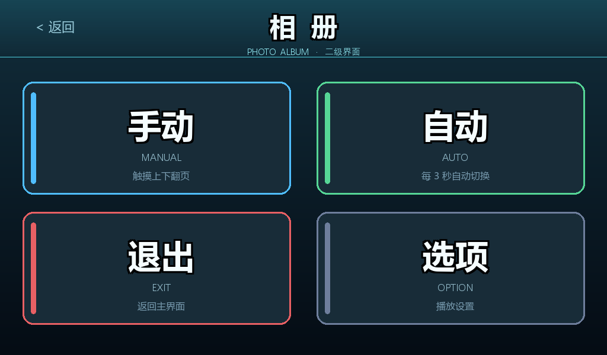

# RK1808 Photo Album — DRM-direct 1024×600 touch frame, with six mini games

[](https://github.com/Wwumin/rk1808-photo-album/actions/workflows/ci.yml)
[](LICENSE)

A complete embedded-Linux C11 application for a Rockchip **RK1808** board driving a
**1024×600** panel straight through DRM (no X11, no Wayland, no Qt, no libpng/libjpeg):
a password-locked photo album with manual/auto slideshow, an options screen, six playable
mini games, and a clean exit path.

Everything you see on screen — backgrounds, buttons, tiles, chess pieces, tetrominoes,
snake body, landscape photos — is **generated by Python scripts in `tools/`**. There are
no binary art assets to license, and no external graphics library in the build.

The interesting part for other developers is that you can **test the whole thing on a PC,
without the board**: the DRM surface is replaced by a plain memory buffer, the touch panel
by a scripted click list, and the test harness runs the real state machine through 46
scripted touches and exports sampled frames.



| Album browser | Landscape sample |
|---|---|
|  |  |

More screenshots: [`preview/`](preview) — button sprites, 2048 tiles, every game screen.

---

## What it does

| Area | Implementation |
|---|---|
| Boot | PIN lock (default `1234`), salted FNV-1a hash in `account.cfg`, 3 failed attempts → 3 s cooldown |
| Main menu | Album / Games / Multimedia (stub) / Other (change PIN) / Exit / Options |
| Album | Manual mode (tap top half = next, bottom half = previous) and auto mode (1/3/5/10 s interval with progress bar) |
| Photos | Discovered by filename (`photo_*.bmp`), decoded lazily and cached, capped at 128 |
| Options | Slide interval 1/3/5/10 s, value shown on screen |
| Games | 2048 (swipe + undo), Minesweeper (9×9/10 mines, first click safe, flag mode), Chinese chess (full move rules + check detection + greedy AI), Tetris (7 tetrominoes, rotation, soft/hard drop), Snake (tap a side to turn), Tic-tac-toe (minimax — you can only draw) |
| Exit | Releases the framebuffer and returns cleanly |

## Platform facts (measured, not assumed)

| Item | Value |
|---|---|
| Panel | 1024 × 600, XRGB8888, memory order `B G R X` |
| Stride | always from `drm.pitch` — **never** assume `width * 4` |
| Images | BMP only: 24-bit full-screen, 32-bit sprites with alpha |
| Touch | auto-detected by scanning `/dev/input/event*` and scoring capabilities |
| Toolchain | `aarch64-linux-gnu-gcc`, `libdrm`, vendor `libDRMwrap.so` |
| Language | C11, `_POSIX_C_SOURCE=200809L` |

## Layout

```
rk1808-photo-album/
├── album/        C sources (~4 kLOC): state machine + UI skeleton + 6 games
├── test/         PC-side tests: DRM/touch stubs, 2048 unit tests, touch-detection unit tests
├── tools/        Python asset generators (this is where all the art comes from)
├── photos/       convert.py — turn your own photos into 1024×600 BMPs
├── preview/      PNG previews of what the generated BMPs look like
├── Makefile      cross build (board) + `assets` / `test` convenience targets
├── build.sh      cross build with a sanity check on the output binary
├── push.sh       scp main + bmp/ + libDRMwrap.so to the board
├── README.zh.md  the original Chinese design notes (much more detailed)
└── LICENSE       MIT
```

## PC tests — no board needed

```bash
cd test
make unit    # unit tests only, ~1 s: 2048 rules + touch-device scoring
make run     # whole app state machine, 46 scripted touches, exports frames, exit 0 = pass
make check   # unit + smoke
```

The stubs live in `test/stub/`: `drm_stub.c` is a memory framebuffer that can dump frames,
`touch_stub.c` replays `test/clicks.txt`, and `test/stub/inc/DRMwrap.h` shadows the vendor
header. Nothing in this path needs Linux `input.h` or a real display.

## Generated assets

```bash
pip install pillow
make assets        # 11 backgrounds, 84 button sprites, tiles, pieces, snake, landscapes…
cd test && make run    # the smoke test reads ../bmp
```

All styling is centralised in `tools/ui_style.py` (four palettes, rounded cards, border,
left accent bar, font sizes). Change one file and every screen follows. Buttons are saved
as hand-written **32-bit BMP headers** so the rounded corners really have `A=0`
(24-bit BMPs have no alpha at all — the loader fills `A=0` and alpha blitting nothing).

To use your own photos: `python photos/convert.py <dir> ../bmp` — scales and centre-crops
to 1024×600, writes `photo_01.bmp`… and validates each header.

## Building for the board

`inc/DRMwrap.h` and `lib/libDRMwrap.so` come from the vendor/course SDK and are **not**
in this repository. Drop them in place, then:

```bash
./build.sh                       # cross-compiles and checks `file main` says aarch64
./push.sh 192.168.1.100          # scp main + bmp/ + lib/libDRMwrap.so to /root/album
ssh root@192.168.1.100 'cd /root/album && ./main'
```

Startup logs which touch device it picked:

```
[touch]   /dev/input/event2     goodix-ts                       looks like a touchscreen
[touch] auto-selected /dev/input/event2
```

If it picks wrong, force it: `./main bmp /dev/input/event1`, or `TOUCH_DEV=...`,
or `./main bmp auto` to re-scan.

## How it fits together

* `display.c` — thin wrapper over `libDRMwrap`: one framebuffer, `present()` = `drmModeSetCrtc`.
* `image.c` — hand-written BMP decoder for 24/32-bit, top-down and bottom-up, blit with
  clipping and optional alpha.
* `draw.c` / `font8x16.c` — points, rects and an 8×16 ASCII bitmap font for HUD text.
* `ui.c` — screen skeleton: background + independent button sprites, pressed state, hit test.
* `touch.c` — evdev reader: `poll()` with timeout, press/release split, swipe synthesis,
  capability-based device selection (`test/autodetect.c` is the pure function behind it).
* `main.c` — the state machine: lock → main → album → photo → options → games → exit.
* Game modules keep their **rules free of any screen dependency** so they can be unit-tested
  (`game2048.c` is the model for this).

## Engineering notes

Five places where this deliberately departs from the vendor sample:

1. **Blocking `read()` → `poll()` with a timeout.** The sample's `get_xy()` waits forever for
   a release, so "auto-advance every 3 s" is impossible: the loop is stuck in `read`.
2. **Hard-coded 1024/600 and `width*4` stride removed.** `pitch` is passed in and blits clip.
3. **Buttons moved out of the backgrounds** into separate 32-bit sprites — you can now show a
   pressed state, and layout lives in `ui.c` instead of being duplicated inside the art.
4. **24-bit → 32-bit sprites.** A 24-bit BMP has no alpha; the loader fills `A=0` and the
   whole sprite disappears.
5. **Single-buffer tearing documented, not hidden.** A second `drmModeAddFB` for double
   buffering is the obvious next step.

Six real bugs the tests caught (each is commented in the source):

1. `collapse_line()` merged and then incremented twice — `[2,2,2,2]` became `[4,2,2]`.
2. Undo used "score == 0" as "no move yet" — the first move can merge nothing.
3. Button ids compared with the wrong prefix (`"exit"` vs `"main_exit"`): tapping Exit did
   nothing and the main loop spun 1.2 million times.
4. A `*/` inside a comment (`ABS_*/REL_*/BTN_*`) ended the block early — looked like an
   encoding error, was a syntax error.
5. 24-bit sprites + alpha blit = invisible buttons.
6. `go_back()`'s switch missed `SCREEN_PIN`, trapping the user on the PIN keypad.

Test-harness lessons that took longer than the app: waits must be **sliced** and compared
against an absolute `CLOCK_MONOTONIC` deadline (otherwise the auto-advance timer never
fires and a `nanosleep` interrupted early re-sends forever), and frames must be **sampled**
(one 1024×600 24-bit BMP is 1.76 MB; hundreds of them is hundreds of MB).

## Known limitations

| Item | Status |
|---|---|
| Multimedia | menu entry only, prints `MULTIMEDIA NOT IMPLEMENTED` |
| Chess AI | greedy (material + position), no alpha-beta |
| Tic-tac-toe AI | full minimax — unbeatable by design |
| Double buffering | not implemented, visible tearing on transitions |
| Image formats | BMP only |
| PIN strength | 4 digits, single-round 32-bit hash — anti-casual only |
| Chinese text | only ASCII has a bitmap font; CJK lives in the baked backgrounds |

## License

MIT — see [LICENSE](LICENSE). The vendor DRM wrapper (`DRMwrap.h`, `libDRMwrap.so`) is not
distributed here and remains under its own terms.
